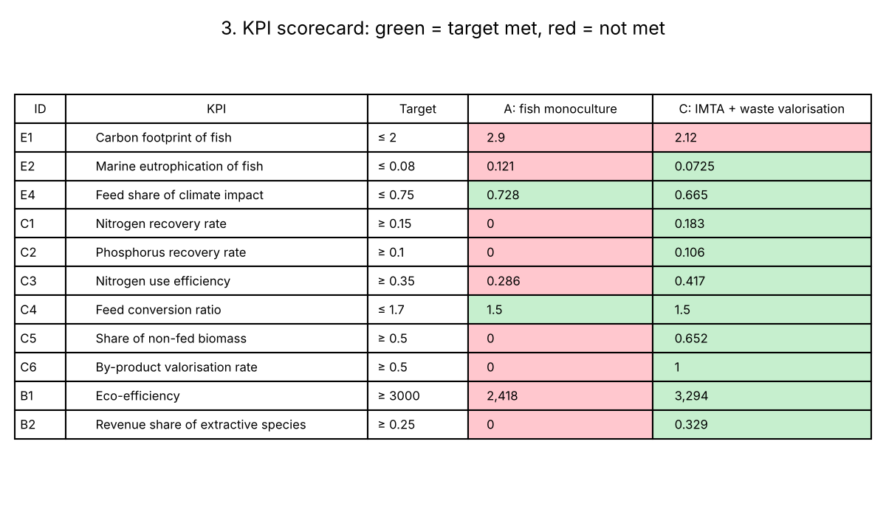
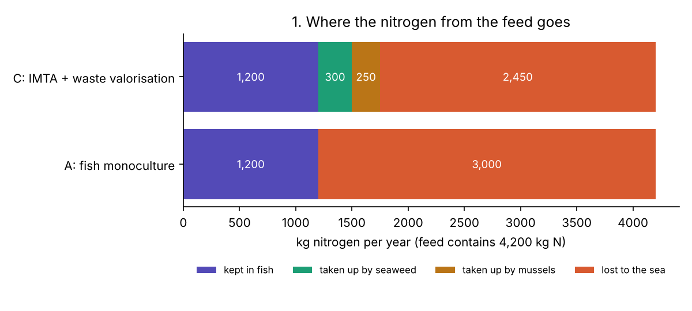
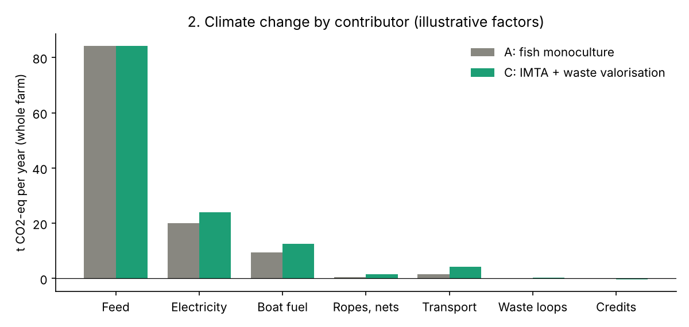
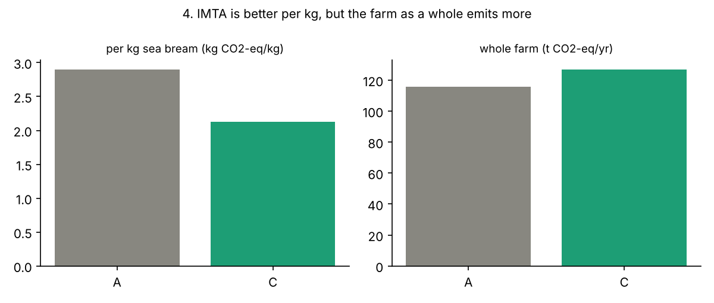
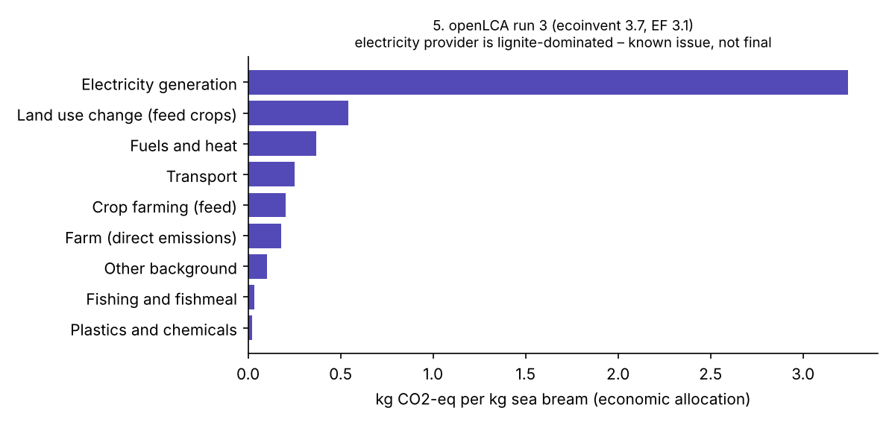

# Life cycle assessment of fish monoculture and IMTA aquaculture

A transparent **circular KPI decision tool** for aquaculture. It takes a life cycle inventory (LCI), runs the
life cycle assessment (LCA), closes the nutrient balance and scores two farm designs on **12 KPIs** for
environment, circularity and economy. The tool is available as an offline **Excel workbook** and as **Python** code with tests.

| Scenario | Design |
|---|---|
| **A** | Gilthead sea bream **monoculture** |
| **C** | **IMTA** (integrated multi-trophic aquaculture): sea bream + seaweed + mussels, **with waste valorisation**: seaweed residues composted, mussel shells reused as lime |

**Functional unit:** 1 kg fresh sea bream at the farm gate, including transport to market. Economic allocation applies.
**Goal and scope:** [`docs/goal_and_scope.md`](docs/goal_and_scope.md) (ISO 14040/44).

> **Status: demonstration (v0.1.0).** Activity data are assumptions, checked against literature ranges.
> KPI values use **illustrative** impact factors, not ecoinvent. ecoinvent results are in
> [`data/openlca_results/`](data/openlca_results/) and have **open issues**, listed in [`docs/known_issues.md`](docs/known_issues.md).


## Open the tool offline

- **Excel:** [`excel/IMTA_KPI_decision_tool.xlsx`](excel/IMTA_KPI_decision_tool.xlsx). It has 14 tabs (goal & scope, metadata, parameters, LCI, nutrient balance,
  factors, LCIA, contribution analysis, allocation, KPI framework, results, openLCA results, sources). All formulas are live.
  Change a yellow cell and every KPI updates. It needs no internet connection and no external links.
- **Findings page:** [`docs/index.html`](docs/index.html) is one self-contained file with all charts embedded. Download it and open it in any browser.
  You can also publish it with GitHub Pages: *Settings → Pages → Branch `main`, folder `/docs`*.

## Key findings

1. **IMTA lowers the footprint per kg of fish.** It drops from 2.90 to 2.12 kg CO2-eq/kg with illustrative factors. IMTA also recovers
   **18 % of the nitrogen** the fish release (0 % in monoculture).
2. **The farm as a whole emits about 9 % more CO2.** The extra comes from more energy, boats, ropes and transport. Per kg looks better only because
   output grows. This is an **absolute-vs-relative trade-off** that a single score would hide.
3. **Waste valorisation lifts the circularity KPIs.** By-product valorisation rises from 0 % to 100 %. Its climate effect is small, though:
   +460 / −400 kg CO2-eq per year, against 84,300 kg from feed.
4. **Feed is the hotspot.** It is two thirds of the climate impact with illustrative factors. In ecoinvent, **land use change from Brazilian soy** is a major contributor.
5. **Model checks matter.** In openLCA, auto-linking chose a lignite-dominated electricity mix instead of Portugal. The farm's nitrogen emission
   also had no characterisation factor in the EF 3.1 (adapted) method. Both are documented as open issues.



## Quick start

```bash
python -m venv .venv && source .venv/bin/activate   # Windows: .venv\Scripts\activate
pip install -r requirements.txt
python run.py           # impacts, nutrient balance, KPIs  -> results/*.csv
python make_charts.py   # findings charts                  -> results/charts/
python build_site.py    # offline findings page            -> docs/index.html
pytest                  # 10 tests
python run.py --factors my_factors.csv   # use your own per-unit factors
```

To get real factors, calculate **1 unit** of each input in openLCA, for example 1 kWh of `market for electricity, low voltage | PT`
with EF 3.1. Put each result into a copy of [`data/factors_illustrative.csv`](data/factors_illustrative.csv).

## Findings in charts

**1. Where the nitrogen from the feed goes.** Of the 4,200 kg N in the feed, 1,200 kg stays in the fish. In IMTA, seaweed and mussels take up
550 kg, so 2,450 kg instead of 3,000 kg is lost to the sea.



**2. Climate change by contributor.** Feed dominates in both designs. IMTA adds electricity, boat fuel, ropes and transport.



**3. Per kg vs whole farm.** C is better per kg of fish but emits more in total.



**4. ecoinvent run (openLCA, EF 3.1).** This run is not final: the electricity provider is lignite-dominated. See [known issues](docs/known_issues.md).



## KPI framework

| ID | Dimension | KPI | Formula | Target |
|---|---|---|---|---|
| E1 | Environment | Carbon footprint of fish | farm CO2-eq × economic share of fish / kg fish | ≤ 2.0 kg CO2-eq/kg |
| E2 | Environment | Marine eutrophication of fish | farm N-eq × share of fish / kg fish | ≤ 0.08 kg N-eq/kg |
| E3 | Environment | Energy demand of fish (Excel only) | farm MJ × share of fish / kg fish | ≤ 40 MJ/kg |
| E4 | Environment | Feed share of climate impact | feed CO2-eq / total | ≤ 75 % |
| C1 | Circularity | Nitrogen recovery rate | N in seaweed + mussels / N released by fish | ≥ 15 % |
| C2 | Circularity | Phosphorus recovery rate | P in seaweed + mussels / P released by fish | ≥ 10 % |
| C3 | Circularity | Nitrogen use efficiency | N in all products / N in feed | ≥ 35 % |
| C4 | Circularity | Feed conversion ratio | kg feed / kg fish | ≤ 1.7 |
| C5 | Circularity | Share of non-fed biomass | (seaweed + mussels) / total harvest | ≥ 50 % |
| C6 | Circularity | By-product valorisation rate | valorised residues + shells / generated | ≥ 50 % |
| B1 | Economy | Eco-efficiency | revenue / t CO2-eq | ≥ 3,000 EUR/t |
| B2 | Economy | Revenue share of extractive species | (seaweed + mussels) / total revenue | ≥ 25 % |

The targets are placeholders. A company would agree its own, for example in a workshop. Every step is explained in [`docs/methodology.md`](docs/methodology.md).

## How it works

| File | What it does |
|---|---|
| `src/imtakpi/model.py` | Reads the LCIS2024 files. Computes impacts as amount × factor (avoided products count as credits), economic allocation, the N and P mass balance and 11 KPIs |
| `run.py` | Writes `results/kpis.csv`, `results/impacts.csv` and `results/nutrient_balance.csv` |
| `make_charts.py` | Draws the findings charts |
| `build_site.py` | Builds the self-contained findings page `docs/index.html` |
| `tests/` | Checks that the nutrient balance closes, that the LCI matches the mass balance, linearity, credits and the known values (the Excel tool gives the same numbers) |

## Project structure

```
data/lci/              foreground LCI in the LCIS2024 structure:
  dataset/             imta-cirkpi-lci.csv (ap_/fp_ columns), parameters.csv
  dataset_properties.csv  name, version, schema, UDI, counts
  metadata/            metadata.csv (dataset, authors, background, licence, sources, glossary)
  network/             directed graph of the inventory (GraphML, open in Cytoscape)
  dependencies/        none
  environment.yml
data/factors_illustrative.csv   illustrative impact factors (replace with per-unit LCA results)
data/openlca_results/  aggregated openLCA results (ecoinvent 3.7 cut-off, EF 3.1), with no raw ecoinvent data
excel/                 IMTA_KPI_decision_tool.xlsx (offline Excel tool)
openlca/               runnable JSON-LD example, ecoinvent 3.7 template, LCI entry sheet
src/imtakpi/           Python package
tests/                 pytest
results/               generated tables and charts
docs/                  goal and scope, methodology, known issues, index.html (findings page)
sources/               REFERENCES.md, references.bib
```

## Related publications

- Hala, A. F., **Chougule, K.**, Cunha, M. E., Caria Mendes, M., Oliveira, I., Bradley, T., Forbes, J., & Galileu Speranza, L. (2024).
  Life cycle assessment of integrated multi-trophic aquaculture: A review on methodology and challenges for its sustainability evaluation.
  *Aquaculture*, 590, 741035. This paper is the basis for the functional unit and allocation choices.


All other sources, and a note on which values come from the literature and which are assumptions, are in [`sources/REFERENCES.md`](sources/REFERENCES.md).

## Licence

- **Code** (`src/`, `tests/`, `*.py`): MIT. See [LICENSE](LICENSE).
- **Data and documents:** CC BY 4.0.
- **ecoinvent:** no ecoinvent data are redistributed here. Only dataset names and aggregated results are included. Recalculating requires your own ecoinvent licence.
