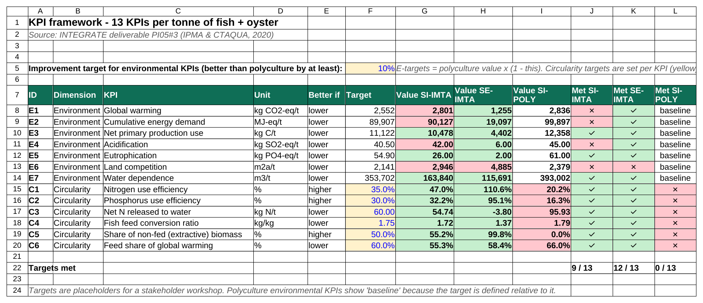
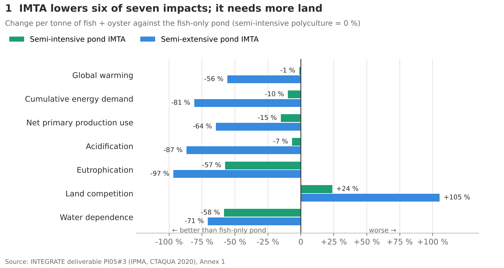
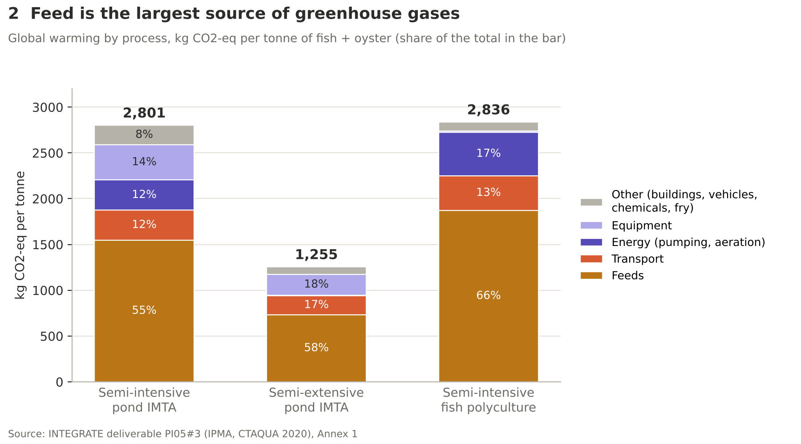
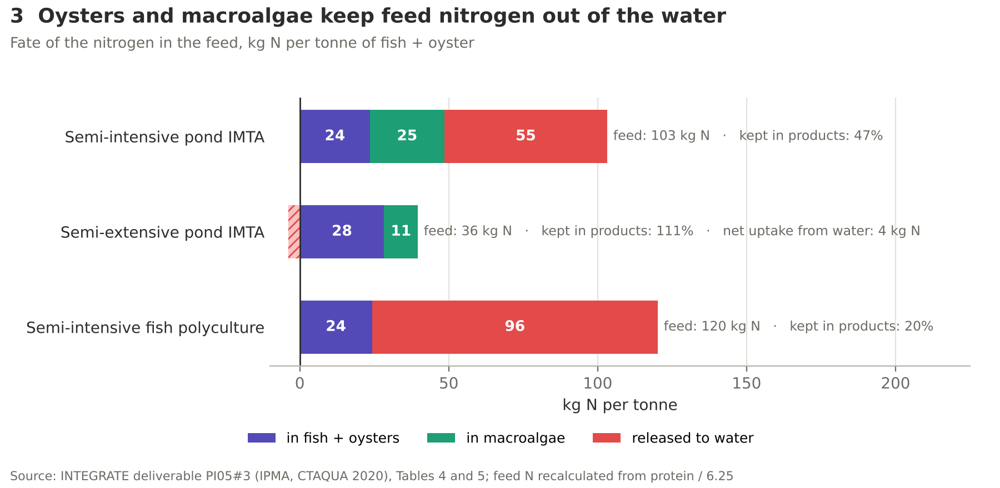
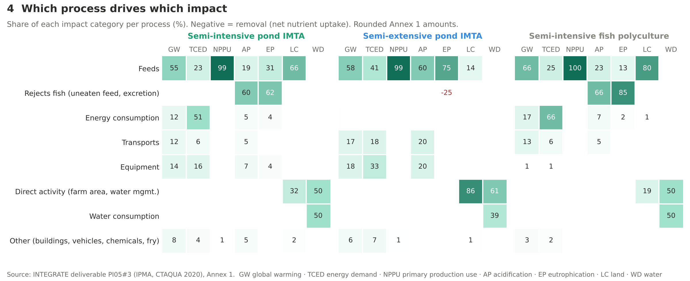
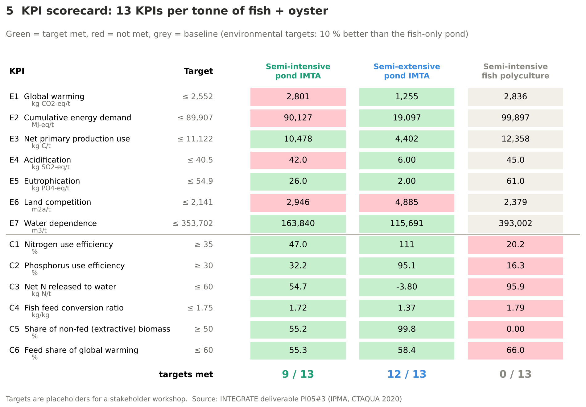
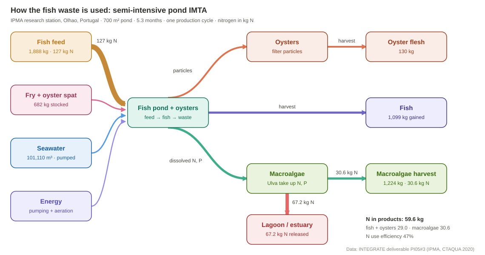

# Life cycle assessment of fish monoculture and IMTA aquaculture

A transparent **KPI decision tool** built on a real pond aquaculture LCA. It takes the inventory and impact results of the
**INTEGRATE project** (Interreg Atlantic Area, deliverable PI05#3), recalculates the nutrient balance, checks the data and scores
three farm designs on **13 KPIs** for environment and circularity. The tool is available as an offline **Excel workbook** and as **Python** code with tests.

| Code | System | Site |
|---|---|---|
| **SI-IMTA** | **Semi-intensive pond IMTA**: meagre, white seabream, mullet + oysters + macroalgae (*Ulva*) | IPMA research station, Olhão, Portugal |
| **SE-IMTA** | **Semi-extensive pond IMTA**: gilthead seabream + oysters, macroalgae pond fed by the fishpond outflow, tidal water exchange | Estero Natural, Cádiz, Spain |
| **SI-POLY** | **Semi-intensive fish polyculture**: meagre + gilthead seabream, fish only (**conventional baseline**) | IPMA research station, Olhão, Portugal |

**Functional unit:** 1 tonne of aquatic product (fish + oyster flesh) at the farm gate, one production cycle. Macroalgae are a co-product outside the functional unit.
**Goal and scope:** [`docs/goal_and_scope.md`](docs/goal_and_scope.md) (ISO 14040/44).

> **Data source.** Inventory (Table 4), nutrient balance (Table 5) and impact results per process (Annex 1) come from
> INTEGRATE deliverable PI05#3 (IPMA & CTAQUA, 2020; software Piscentool). The KPI framework, targets, scaling, nutrient re-calculation
> and data checks are added here. Every transcribed number is in [`make_data.py`](make_data.py) with its table reference.

## Open the tool offline

- **Excel:** [`excel/IMTA_KPI_decision_tool.xlsx`](excel/IMTA_KPI_decision_tool.xlsx). 12 tabs: README, goal & scope, metadata, inventory, LCI per tonne,
  nutrient balance, LCIA (Annex 1), comparison, KPI framework, dashboard, data checks, sources. All results are live formulas: change a yellow cell
  (for example the 10 % improvement target or the feed amount) and every KPI updates. No internet, no macros, no external links.
  [](excel/IMTA_KPI_decision_tool.xlsx)
- **Findings page:** [`docs/index.html`](docs/index.html) – one self-contained file with all charts embedded. Download it and open it in any browser.
- **Flow diagrams:** [`docs/flow.html`](docs/flow.html) – one tab per system.

## Key findings

1. **Semi-extensive IMTA has the lowest impacts in 6 of 7 categories:** global warming −56 %, energy −81 %, eutrophication −97 % against the polyculture.
   It even takes up nitrogen from the estuary (net uptake 0.5 kg N per cycle): fish and oysters also eat natural food.
2. **Semi-intensive IMTA vs polyculture** (same station, same target fish density): **eutrophication −57 %** and **water dependence −58 %**.
   Oysters and macroalgae keep **47 % of the feed nitrogen** in products, against 20 % in the polyculture. Global warming is almost equal (−1 %).
3. **Feed is the hotspot:** 55–66 % of global warming and over 99 % of primary production use. Uneaten feed and excretion
   ("Rejects fish") cause 59–84 % of acidification and eutrophication in the semi-intensive systems.
4. **Land is the trade-off:** the IMTA systems need +24 % (semi-intensive) and +105 % (semi-extensive) more land per tonne.
5. **Data checks:** 37 of 39 cross-checks between the report's tables pass. Two findings are documented in [`docs/known_issues.md`](docs/known_issues.md):
   the semi-extensive FCR of 0.56 divides feed by fish **and** oyster gain, and the polyculture land value does not follow the pond-area rule.

## Results

All figures are per tonne of aquatic product (fish + oyster flesh). The fish-only pond (semi-intensive polyculture) is the baseline.

### Figure 1 – Impacts against the fish-only pond
Both IMTA systems are lower in six of seven categories. The semi-extensive IMTA cuts most; land competition is the trade-off.



### Figure 2 – Global warming by process
Feed is 55–66 % of the total. Pumping energy matters only in the semi-intensive ponds; equipment weighs more in the short IMTA cycles.



### Figure 3 – Where the nitrogen in the feed goes
Oysters and macroalgae keep 47 % of the feed nitrogen in products in the semi-intensive IMTA, against 20 % in the fish-only pond.



### Figure 4 – Which process drives which impact
Feeds drive global warming and primary production use; uneaten feed and excretion ("Rejects fish") drive acidification and eutrophication;
direct farm activity and water use drive land and water.



### Figure 5 – KPI scorecard



### Figure 6 – How the fish waste is used (semi-intensive IMTA, one production cycle)

[](docs/flow.html)

59.6 of 127 kg N end up in fish, oysters and macroalgae; 67 kg N is released. Other systems:
[fish-only pond](results/charts/06_flow_si_poly.svg) (589 of 738 kg N released) and
[semi-extensive IMTA](results/charts/06_flow_se_imta.svg) (net uptake from the estuary).

## KPI framework

| ID | Dimension | KPI | Formula | Target |
|---|---|---|---|---|
| E1–E7 | Environment | Global warming, energy demand, primary production use, acidification, eutrophication, land competition, water dependence per tonne | Annex 1 total | at least 10 % below the polyculture |
| C1 | Circularity | Nitrogen use efficiency | N in fish + oysters + macroalgae / N in feed | ≥ 35 % |
| C2 | Circularity | Phosphorus use efficiency | P in all products / P in feed | ≥ 30 % |
| C3 | Circularity | Net N released to water | (N in feed − N in products) per tonne | ≤ 60 kg N/t |
| C4 | Circularity | Fish feed conversion ratio | feed / fish gain | ≤ 1.75 |
| C5 | Circularity | Share of non-fed biomass | (oyster + macroalgae) / total harvest | ≥ 50 % |
| C6 | Circularity | Feed share of global warming | Feeds / total GW | ≤ 60 % |

Result: semi-intensive IMTA **9/13**, semi-extensive IMTA **12/13**, polyculture **0/13** (it is the baseline for E1–E7).
The targets are placeholders that a company would agree in a workshop. Every step is explained in [`docs/methodology.md`](docs/methodology.md).

## Quick start

```bash
python -m venv .venv && source .venv/bin/activate   # Windows: .venv\Scripts\activate
pip install -r requirements.txt
python make_data.py     # report tables -> data/report/*.csv, data/lci/ (LCIS2024)
python run.py           # KPIs, impacts, nutrient balance, data checks -> results/*.csv
python make_excel.py    # offline Excel tool -> excel/
python make_charts.py   # figures 1-5 (PNG)       -> results/charts/
python make_flow.py     # flow diagrams (SVG)     -> results/charts/, docs/flow.html
python build_site.py    # offline findings page -> docs/index.html
pytest                  # 35 tests
```

## How it works

| File | What it does |
|---|---|
| `make_data.py` | All numbers transcribed from the report (Tables 4–5, Annex 1), written to `data/report/` and as an LCIS2024 inventory to `data/lci/` |
| `src/imtakpi/model.py` | Scales to the functional unit, recalculates the N and P balance, evaluates 13 KPIs, runs 39 data checks |
| `run.py` | Writes `results/kpis.csv`, `impacts_per_tonne.csv`, `nutrient_balance.csv`, `data_checks.csv` |
| `make_excel.py` | Builds the Excel tool with live formulas (same results as Python) |
| `make_charts.py`, `make_flow.py`, `build_site.py` | Figures, flow diagrams and the findings page |
| `tests/` | Report totals reproduced, feed N/P = Table 5, N balance closes, functional unit = Annex 1 water, process sums, known KPI values |

## Project structure

```
data/report/           systems, inventory (Table 4), nutrients (Table 5), impacts per process (Annex 1)
data/lci/              foreground LCI per functional unit in the LCIS2024 structure:
  dataset/             imta-integrate-lci.csv (ap_/fp_ columns), parameters.csv
  dataset_properties.csv  name, version, schema, UDI, counts
  metadata/            metadata.csv
  network/             directed graph of the inventory (GraphML)
  dependencies/, environment.yml
excel/                 IMTA_KPI_decision_tool.xlsx (offline Excel tool)
src/imtakpi/           Python package
tests/                 pytest
results/               generated tables and charts
docs/                  goal and scope, methodology, known issues, index.html, flow.html
sources/               REFERENCES.md, references.bib
```

## Related publications

- Hala, A. F., **Chougule, K.**, Cunha, M. E., Caria Mendes, M., Oliveira, I., Bradley, T., Forbes, J., & Galileu Speranza, L. (2024).
  Life cycle assessment of integrated multi-trophic aquaculture: A review on methodology and challenges for its sustainability evaluation.
  *Aquaculture*, 590, 741035. This paper discusses the functional unit and allocation choices that this study has to make.

Data source: INTEGRATE project (2020), deliverable PI05#3, Interreg Atlantic Area EAPA_232/2016 (IPMA, CTAQUA). All other sources are in [`sources/REFERENCES.md`](sources/REFERENCES.md).

## Licence

- **Code** (`src/`, `tests/`, `*.py`): MIT. See [LICENSE](LICENSE).
- **KPI layer, derived files and documents:** CC BY 4.0.
- **Report data** (`data/report/`): from INTEGRATE deliverable PI05#3; the rights remain with the INTEGRATE partners.
