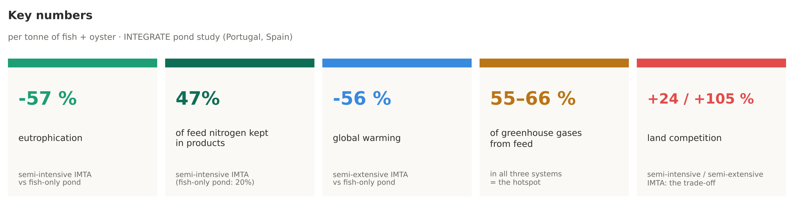
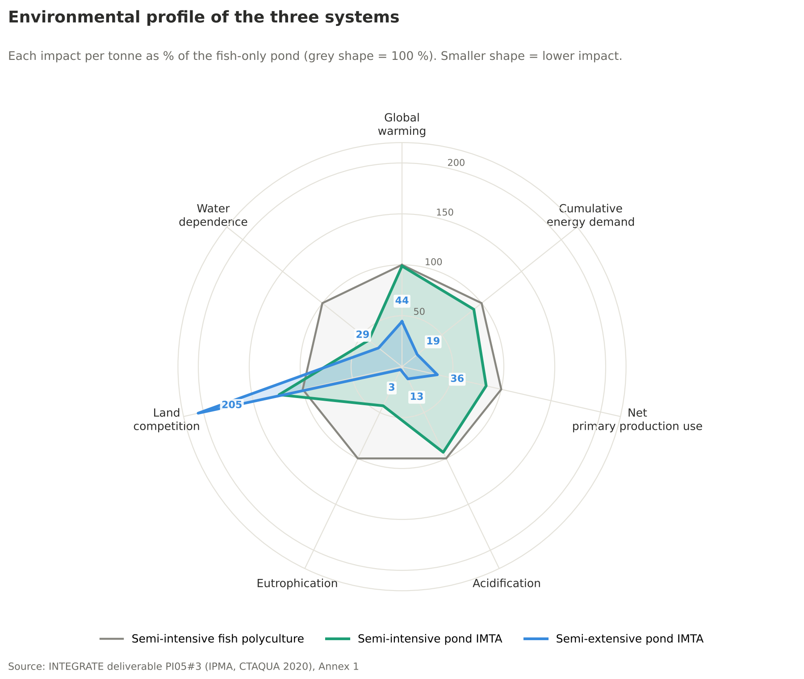
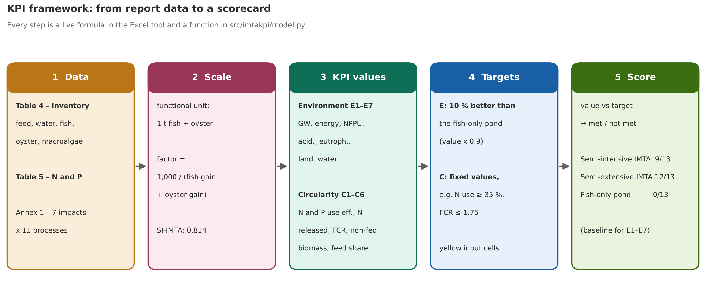
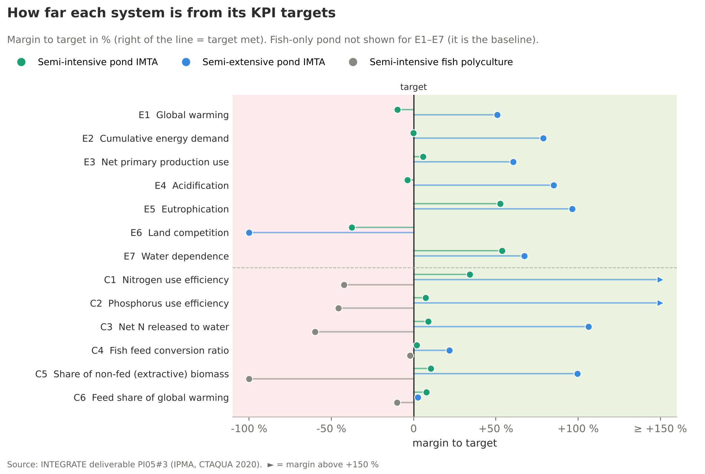

# Life cycle assessment of fish monoculture and IMTA aquaculture

A transparent **KPI decision tool** built on a real pond aquaculture LCA. It takes the inventory and impact results of the
**INTEGRATE project** (Interreg Atlantic Area, deliverable PI05#3), recalculates the nutrient balance, checks the data and scores
three farm designs on **13 KPIs** for environment and circularity. The tool is available as an offline **Excel workbook** and as **Python** code with tests.

| Code | System | Site |
|---|---|---|
| **SI-IMTA** | **Semi-intensive pond IMTA**: meagre, white seabream, mullet + oysters + macroalgae (*Ulva*) | IPMA research station, Olhão, Portugal |
| **SE-IMTA** | **Semi-extensive pond IMTA**: gilthead seabream + oysters, macroalgae pond fed by the fishpond outflow, tidal water exchange | Estero Natural, Cádiz, Spain |
| **SI-POLY** | **Semi-intensive fish polyculture**: meagre + gilthead seabream, fish only (**conventional baseline**) | IPMA research station, Olhão, Portugal |

**Functional unit:** 1 tonne of aquatic product (fish + oyster flesh) at the farm gate, one production cycle. Macroalgae are a co-product outside the functional unit.
**Goal and scope:** [`docs/goal_and_scope.md`](docs/goal_and_scope.md) (ISO 14040/44).

> **Data source.** Inventory (Table 4), nutrient balance (Table 5) and impact results per process (Annex 1) come from
> INTEGRATE deliverable PI05#3 (IPMA & CTAQUA, 2020; software Piscentool). The KPI framework, targets, scaling, nutrient re-calculation
> and data checks are added here. Every transcribed number is in [`make_data.py`](make_data.py) with its table reference.

## Open the tool offline

- **Excel:** [`excel/IMTA_KPI_decision_tool.xlsx`](excel/IMTA_KPI_decision_tool.xlsx) · **[preview in the browser](https://view.officeapps.live.com/op/view.aspx?src=https%3A%2F%2Fraw.githubusercontent.com%2Fmalleshkomal%2FLife-cycle-assessment-of-Integrated-Multi-Trophical-Aquaculture-%2Fmain%2Fexcel%2FIMTA_KPI_decision_tool.xlsx)** (all tabs, no download). 16 tabs: README, goal & scope, **flow diagrams**, metadata, inventory, LCI per tonne,
  nutrient balance, LCIA (Annex 1), **contribution analysis**, comparison, KPI framework, dashboard, **charts**, **figures**, data checks, sources.
  19 live charts: contribution per process for each system and each impact category (with a heatmap of shares), environmental profile (radar),
  change against the fish-only pond, nitrogen and phosphorus fate, KPI targets met and margin to target. The *Figures* tab holds the report PNGs, each with its data table (live formulas) beside it; the *Flow diagrams* tab holds the three flow diagrams with their flows.
  All results are live formulas: change a yellow cell
  (for example the 10 % improvement target or the feed amount) and every KPI updates. No internet, no macros, no external links.
- **Findings page:** [`docs/index.html`](docs/index.html) – one self-contained file with all charts embedded. Download it and open it in any browser.
- **Flow diagrams:** [`docs/flow.html`](docs/flow.html) – one tab per system.

## Key findings



### 1. Both IMTA systems lower six of seven impacts – the semi-extensive one by far the most
Against the fish-only pond, the semi-extensive IMTA cuts global warming by 56 %, energy by 81 % and eutrophication by 97 %.
It even takes up nitrogen from the estuary (net uptake), because fish and oysters also eat natural food. The semi-intensive IMTA
has almost the same global warming (−1 %) but much lower eutrophication (−57 %) and water dependence (−58 %).

<table><tr>
<td width="50%"></td>
<td width="50%"></td>
</tr></table>

### 2. Oysters and macroalgae keep nitrogen out of the water
In the semi-intensive IMTA, 47 % of the feed nitrogen ends up in fish, oysters and macroalgae, against 20 % in the fish-only pond.
Released nitrogen falls from 96 to 55 kg N per tonne.


[](docs/flow.html)

Other systems: [fish-only pond](results/charts/06_flow_si_poly.svg) · [semi-extensive IMTA](results/charts/06_flow_se_imta.svg) · all three with tabs in [`docs/flow.html`](docs/flow.html).

### 3. Feed is the hotspot
Feed causes 55–66 % of global warming and over 99 % of primary production use. Uneaten feed and excretion ("Rejects fish") cause
59–84 % of acidification and eutrophication in the semi-intensive ponds. Pumping energy matters only where water is pumped, not with tides.

<table><tr>
<td width="45%"></td>
<td width="55%"></td>
</tr></table>

### 4. Land is the trade-off
Both IMTA systems need more land per tonne: +24 % (semi-intensive) and +105 % (semi-extensive). It is the only category where the fish-only pond is better.

### 5. The data were checked
37 of 39 cross-checks between the report's tables pass (feed N and P, water per tonne, process sums). Two findings are documented in
[`docs/known_issues.md`](docs/known_issues.md): the semi-extensive FCR of 0.56 divides feed by fish **and** oyster gain, and the fish-only pond's
land value does not follow the report's pond-area rule.

## KPI framework

The framework turns the LCA results into **13 KPIs** in two dimensions – **7 environmental** (one per impact category) and
**6 circularity** KPIs – each with a target and a pass/fail result.



**How the scorecard is built**

1. **Data** – inventory (Table 4), nitrogen and phosphorus (Table 5) and impacts per process (Annex 1) of the report.
2. **Scale** to the functional unit: factor = 1,000 / (fish gain + oyster gain). Semi-intensive IMTA: 1,000 / 1,229 = 0.814.
3. **KPI values** – environmental KPIs are the Annex 1 totals; circularity KPIs are calculated, e.g. nitrogen use efficiency =
   (29.0 + 30.6) / 126.9 = 47 %, where N in feed = 1,888 kg × 42 % protein / 6.25.
4. **Targets** – environmental: at least **10 % better than the fish-only pond** (value × 0.9); circularity: fixed values. All targets are
   yellow input cells in Excel, to be agreed with stakeholders.
5. **Score** – `value ≤ target` (or `≥` when higher is better) gives ✅ or ❌; the ticks are counted.

| ID | KPI | Unit | Formula | Target | Semi-intensive IMTA | Semi-extensive IMTA | Fish-only pond |
|---|---|---|---|---|---|---|---|
| E1 | Global warming | kg CO2-eq/t | Annex 1 total | ≤ 2,552 | 2,801 ❌ | 1,255 ✅ | 2,836 ⚪ |
| E2 | Cumulative energy demand | MJ-eq/t | Annex 1 total | ≤ 89,907 | 90,127 ❌ | 19,097 ✅ | 99,897 ⚪ |
| E3 | Net primary production use | kg C/t | Annex 1 total | ≤ 11,122 | 10,478 ✅ | 4,402 ✅ | 12,358 ⚪ |
| E4 | Acidification | kg SO2-eq/t | Annex 1 total | ≤ 40.5 | 42.0 ❌ | 6.00 ✅ | 45.0 ⚪ |
| E5 | Eutrophication | kg PO4-eq/t | Annex 1 total | ≤ 54.9 | 26.0 ✅ | 2.00 ✅ | 61.0 ⚪ |
| E6 | Land competition | m2a/t | Annex 1 total | ≤ 2,141 | 2,946 ❌ | 4,885 ❌ | 2,379 ⚪ |
| E7 | Water dependence | m3/t | Annex 1 total | ≤ 353,702 | 163,840 ✅ | 115,691 ✅ | 393,002 ⚪ |
| C1 | Nitrogen use efficiency | % | N in fish + oysters + macroalgae / N in feed | ≥ 35 % | 47 % ✅ | 111 % ✅ | 20 % ❌ |
| C2 | Phosphorus use efficiency | % | P in all products / P in feed | ≥ 30 % | 32 % ✅ | 95 % ✅ | 16 % ❌ |
| C3 | Net N released to water | kg N/t | (N in feed − N in products) per tonne | ≤ 60.0 | 54.7 ✅ | -3.80 ✅ | 95.9 ❌ |
| C4 | Fish feed conversion ratio | kg/kg | feed / fish gain | ≤ 1.75 | 1.72 ✅ | 1.37 ✅ | 1.79 ❌ |
| C5 | Share of non-fed (extractive) biomass | % | (oyster + macroalgae) / total harvest | ≥ 50 % | 55 % ✅ | 100 % ✅ | 0 % ❌ |
| C6 | Feed share of global warming | % | Feeds / total global warming | ≤ 60 % | 55 % ✅ | 58 % ✅ | 66 % ❌ |
| | **Targets met** | | | | **9 / 13** | **12 / 13** | **0 / 13** |

✅ met · ❌ not met · ⚪ baseline (the fish-only pond is the reference for E1–E7)

<table><tr>
<td width="50%"></td>
<td width="50%"></td>
</tr></table>

The same framework in the **Excel tool** (tab *KPI framework*) – change a target or an input and every KPI updates.
[Preview in the browser](https://view.officeapps.live.com/op/view.aspx?src=https%3A%2F%2Fraw.githubusercontent.com%2Fmalleshkomal%2FLife-cycle-assessment-of-Integrated-Multi-Trophical-Aquaculture-%2Fmain%2Fexcel%2FIMTA_KPI_decision_tool.xlsx) · [download](excel/IMTA_KPI_decision_tool.xlsx)

Every step is explained in [`docs/methodology.md`](docs/methodology.md).

## Quick start

```bash
python -m venv .venv && source .venv/bin/activate   # Windows: .venv\Scripts\activate
pip install -r requirements.txt
python make_data.py     # report tables -> data/report/*.csv, data/lci/ (LCIS2024)
python run.py           # KPIs, impacts, nutrient balance, data checks -> results/*.csv
python make_excel.py    # offline Excel tool -> excel/
python make_charts.py   # all figures (PNG)       -> results/charts/
python make_flow.py     # flow diagrams (SVG)     -> results/charts/, docs/flow.html
python build_site.py    # offline findings page -> docs/index.html
pytest                  # 35 tests
```

## How it works

| File | What it does |
|---|---|
| `make_data.py` | All numbers transcribed from the report (Tables 4–5, Annex 1), written to `data/report/` and as an LCIS2024 inventory to `data/lci/` |
| `src/imtakpi/model.py` | Scales to the functional unit, recalculates the N and P balance, evaluates 13 KPIs, runs 39 data checks |
| `run.py` | Writes `results/kpis.csv`, `impacts_per_tonne.csv`, `nutrient_balance.csv`, `data_checks.csv` |
| `make_excel.py` | Builds the Excel tool with live formulas (same results as Python) |
| `make_charts.py`, `make_flow.py`, `build_site.py` | Figures, flow diagrams and the findings page |
| `tests/` | Report totals reproduced, feed N/P = Table 5, N balance closes, functional unit = Annex 1 water, process sums, known KPI values |

## Project structure

```
data/report/           systems, inventory (Table 4), nutrients (Table 5), impacts per process (Annex 1)
data/lci/              foreground LCI per functional unit in the LCIS2024 structure:
  dataset/             imta-integrate-lci.csv (ap_/fp_ columns), parameters.csv
  dataset_properties.csv  name, version, schema, UDI, counts
  metadata/            metadata.csv
  network/             directed graph of the inventory (GraphML)
  dependencies/, environment.yml
excel/                 IMTA_KPI_decision_tool.xlsx (offline Excel tool)
src/imtakpi/           Python package
tests/                 pytest
results/               generated tables and charts
docs/                  goal and scope, methodology, known issues, index.html, flow.html
sources/               REFERENCES.md, references.bib
```

## Related publications

- Hala, A. F., **Chougule, K.**, Cunha, M. E., Caria Mendes, M., Oliveira, I., Bradley, T., Forbes, J., & Galileu Speranza, L. (2024).
  Life cycle assessment of integrated multi-trophic aquaculture: A review on methodology and challenges for its sustainability evaluation.
  *Aquaculture*, 590, 741035. This paper discusses the functional unit and allocation choices that this study has to make.

Data source: INTEGRATE project (2020), deliverable PI05#3, Interreg Atlantic Area EAPA_232/2016 (IPMA, CTAQUA). All other sources are in [`sources/REFERENCES.md`](sources/REFERENCES.md).

## Licence

- **Code** (`src/`, `tests/`, `*.py`): MIT. See [LICENSE](LICENSE).
- **KPI layer, derived files and documents:** CC BY 4.0.
- **Report data** (`data/report/`): from INTEGRATE deliverable PI05#3; the rights remain with the INTEGRATE partners.
